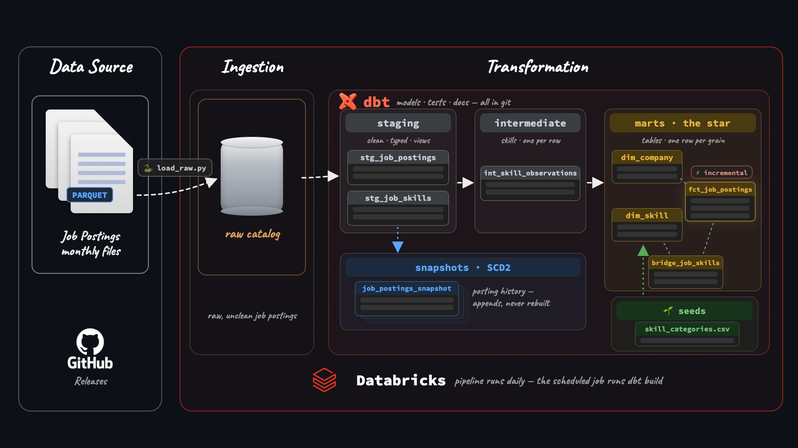

# 🏢 DBT and Databricks Analytics Pipeline

A production dbt pipeline on **Databricks** built on raw job-posting scrapes, rebuilt automatically by a scheduled job with zero hardcoded secrets.

- Shapes raw data into a tested star schema (Fact and Dimension tables)
- Uses custom Jinja macros to parse messy salary ranges into clean columns
- Loads incrementally and runs automatically on a Databricks Job

### 🗺️ Project Architecture

| Component | What It Does | Location |
| :--- | :--- | :--- |
| **Star Schema** | Models the raw data into Fact, Dimension, and Bridge tables on a strict grain. | [`analytics/models/marts/`](analytics/models/marts/) |
| **SCD2 Snapshots** | Tracks a year of salary history by backfilling and updating changes over time. | [`analytics/snapshots/`](analytics/snapshots/) + [`scripts/`](scripts/) |
| **Incremental Fact** | Uses a `MERGE` on `job_id` so only newly scraped days are processed. | [`fact_job_postings.sql`](analytics/models/marts/fact_job_postings.sql) |
| **Custom Macros** | Handles complex logic, like parsing messy salary strings and overriding built-ins. | [`analytics/macros/`](analytics/macros/) |
| **Data Tests** | Uses generic, singular, and custom tests to catch data issues before they ship. | [`analytics/tests/`](analytics/tests/) + YAML configs |
| **Environments** | Separates work into distinct `dev` and `prod` catalogs (laptop vs. scheduled job). | Unity Catalog (`dev` / `prod`) |
| **Orchestration** | Runs automatically every night via Databricks Jobs without hardcoded credentials. | Databricks → Jobs & Pipelines |
| **Analyses** | Stores exploratory queries directly alongside the models they investigate. | [`analytics/analyses/`](analytics/analyses/) |

`dbt build` compiles SQL, materializes models, and fails the run if any test fails.

### 🚀 Production

Databricks owns the runtime — storage, compute, and the schedule, one platform:

*   **Dev and prod as catalogs:** laptop builds land in the `dev` catalog; only the scheduled job writes the same schemas into `prod`.
*   **Scheduled Databricks Job** runs the whole pipeline nightly: `load_raw` (the ingest notebook), then `dbt deps` → `dbt debug` → `dbt build`, pulling the repo straight from GitHub.

### 📸 Snapshots

The marts keep each job's latest scrape, while the snapshot table tracks every version (SCD2 across 13 columns):

*   **504,591 versions** across 491,140 jobs, with 10,187 jobs showing real change history
*   **2,756 postings** had a salary change between scrapes
*   **Analyses:** [`top_churning_companies.sql`](analytics/analyses/top_churning_companies.sql) (Meta edits the most postings — 415) and [`top_salary_swings.sql`](analytics/analyses/top_salary_swings.sql) (one posting jumped from $60K to $1,000,000, catching a typo mid-edit)

### 📖 Docs

The documentation site is generated directly from the dbt models, YAMLs, and tests:

🔗 **[View the Live dbt Docs Site](https://arjuntheanalyst.github.io/DBT-and-Databricks-Analytics-Pipeline/)**

It includes:
*   The full lineage graph (raw → staging → marts)
*   Model and column descriptions
*   Data test coverage

Because `persist_docs` is enabled, these same descriptions are also pushed directly into Unity Catalog alongside the tables.

### 🏁 Conclusion

This project demonstrates a **production-ready Analytics Engineering workflow** on Databricks. By combining **dbt** for modular transformations, **Unity Catalog** for governance, and **Databricks Workflows** for orchestration, raw data is systematically modeled into a tested Star Schema. 

The pipeline runs entirely in the cloud, featuring **incremental processing**, **SCD2 historical snapshots**, and a fully automated **zero-secret CI/CD workflow** that serves final tables directly to BI tools without any manual intervention.